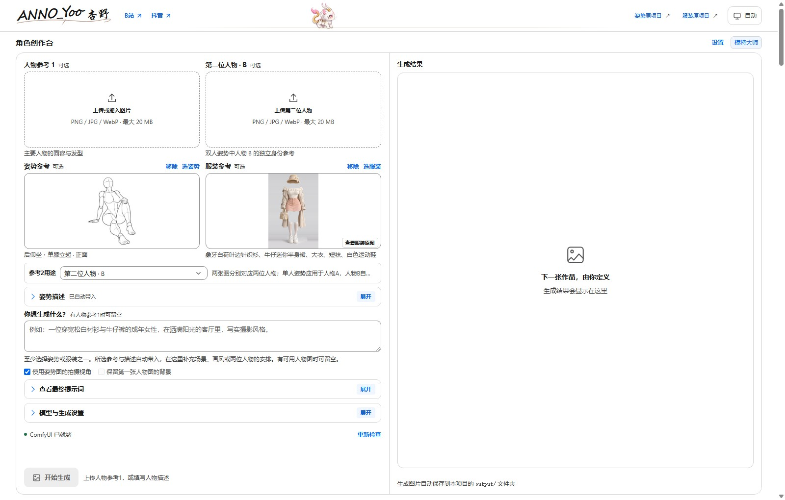
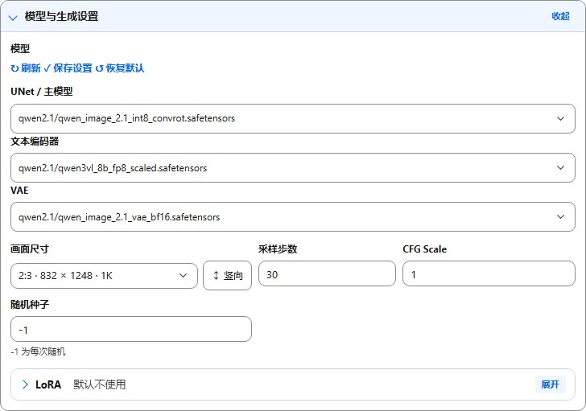
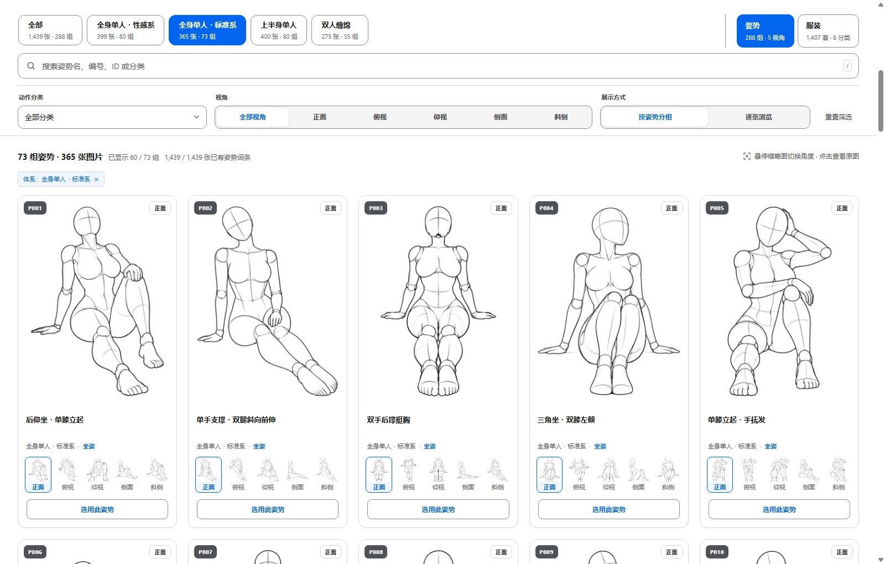
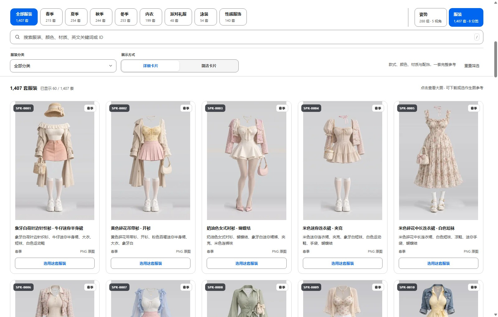

# 模特大师

把人物参考、姿势参考、服装和场景放在同一个本地创作台里，选择参考、补充画面要求，再生成图片。

当前版本：**1.2.5**。支持外接生图 API、内置 WebUI 和接入已有 ComfyUI。

## 可以做什么

- 浏览 **288 组姿势、1,439 张多角度姿势图、1,407 套服装**，搜索后直接选用。
- 上传人物参考，组合姿势、服装与场景；第二张参考可用于第二位人物、人物补充或环境。
- 在生成面板选择 UNet、文本编码器和 VAE，保存常用模型设置，也可恢复默认。
- 自动扫描整合包和额外模型目录；接入已有 ComfyUI 时，读取该服务实际可用的模型。
- 默认 **30 步、CFG 1、2:3 竖图 832×1248（1K）**，保留较大尺寸预设和横竖切换。
- 默认不加载 LoRA；需要时逐个添加、删除和调整权重，没有固定个数上限。
- 图片自动保存到本项目的 `output/`；模型、密钥和个人设置保存在本机。

## 下载

- **[完整整合包 · 夸克网盘（不含模型）](https://pan.quark.cn/s/bf5f6d71666f)**：首次使用下载这个，包含程序、完整图库、Node.js、Python、PyTorch、ComfyUI 和 VC++ 运行库安装器，**不含生图模型**。
- **[Qwen 模型三件套 · 夸克网盘](https://pan.quark.cn/s/80d2ba176a41)**：内置本地生图需要另行准备模型；已有 ComfyUI 可以沿用原模型。
- [GitHub 程序更新仓库](https://github.com/chengjing84/annoyoo-studio-updates)：为已有整合包提供程序更新，不包含完整运行环境和图库。

**整合包解压密码：`xingye`。** 这是压缩包解压密码，不是网盘提取码。下载后先完整解压，再运行启动脚本。

## 界面预览

创作界面：组合姿势与服装参考，补充画面要求。



模型与生成设置：选择模型、调整画面尺寸和采样参数，按需添加 LoRA。



姿势参考库：按体系、动作和视角筛选，直接选用。



服装参考库：按分类浏览、搜索并选用服装。



## 开始使用

1. 将完整整合包解压到有写入权限的本地目录，例如 `D:\AI-Studio-1.2.5`。无需使用作者电脑的盘符或路径。
2. 双击 **启动创作台.cmd**，在网页中选择使用方式。
3. 完成所选方式的配置，按需上传人物、选择姿势或服装，填写画面要求后开始生成。

| 使用方式 | 准备内容 |
| --- | --- |
| 外接生图 API | 填写接口地址、API Key 和模型名称，无需本地生图环境 |
| 内置 WebUI | 运行环境已包含在整合包中，另行准备 Qwen 模型三件套 |
| 接入已有 ComfyUI | 填写运行中的服务地址，或选择已有安装目录与 Python，沿用原来的模型 |

内置生图环境面向 **Windows x64 / NVIDIA**，显卡驱动需支持 **CUDA 13**。已有 ComfyUI 需要支持对应的 Qwen-Image 2.1 模型和工作流节点。

默认模型目录如下，`models` 与 **启动创作台.cmd** 同级。手动下载后保持目录层级，点击 **检测模型**；不要放成 `models/models/`。

```text
AI-Studio-1.2.5/
├── 启动创作台.cmd
├── 更新创作台.cmd
├── runtime/
└── models/
    ├── diffusion_models/qwen2.1/qwen_image_2.1_int8_convrot.safetensors
    ├── text_encoders/qwen2.1/qwen3vl_8b_fp8_scaled.safetensors
    └── vae/qwen2.1/qwen_image_2.1_vae_bf16.safetensors
```

## 1.2.5 更新内容

本版整合了社区代码修改与后续修复：模型选择和默认值保存、模型目录自动识别、已有 ComfyUI 模型读取、旧目录设置迁移、逐个添加 LoRA、生成任务恢复，以及生图区滚轮和顶部动画的性能修复。安装页和模型设置中的夸克模型链接已同步更新。

## 已有整合包如何更新

1. 等待生成、下载任务结束，运行 **停止创作台.cmd**。
2. 运行 **更新创作台.cmd**，确认后自动下载、校验、备份并更新。
3. 更新完成后启动网页，按 **Ctrl+F5** 刷新。

适用于 **1.2.0 及之后的兼容整合包**，具体要求见 `update-manifest.json`。更新保留 `runtime/`、`models/`、`output/`、`.local/` 和完整图库，不需要重下模型或环境。

如果 GitHub 连接失败，或旧整合包缺少更新工具，可以在仓库点击 **Code → Download ZIP**，完整解压后运行 **安装或更新.cmd**，选择原整合包目录进行离线更新。请保持更新窗口打开直至完成；替换或重启失败时，工具会恢复原程序文件。

## 本地文件与换盘

个人设置和密钥在 `.local/`，生成图片在 `output/`，模型在 `models/`。备份或迁移时保留这些目录，分享整合包时排除个人设置、任务和生成图片。

换盘或改名之前先停止创作台，再移动整个文件夹并保留内部结构。手动指定的外部模型、ComfyUI 或 Python 目录如果也搬动了，需要到 **安装与模式** 中重新选择。

## 致谢与来源

感谢 **石头大佬** 提供的建议和代码修改。

感谢原姿势图库、服装图库及相关开源项目。原项目入口、许可证和来源说明继续保留，详见随包的 `docs/原项目说明.md`、`costume/SOURCE.md` 和 [LICENSE](LICENSE)。

详细操作见 [完整使用说明](更新文件/docs/统一版使用说明.md)，社区原始修改说明见 [社区修改说明](更新文件/docs/社区修改说明.html)。
